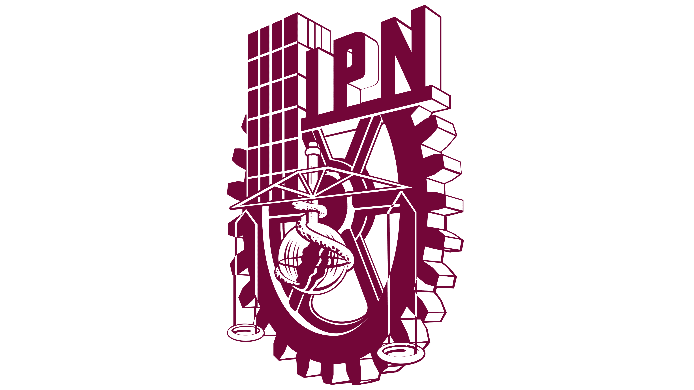

# 👋 Hi, I'm Angel Juarez

**IT Manager 👨‍💼 · IT Project Manager 📈 · Developer 💻**

🇲🇽 Spanish (native) · 🇺🇸 English (professional) · 🇫🇷 French (intermediate) · 🇯🇵 Japanese (basic)

---

## 📖 About me

Manager with experience in infrastructure and software development and support, with a strong focus on creating the architecture, designing, and developing applications. I leverage state-of-the-art technologies that help respond to finance and business reality, building architectures that ensure the scalability, continuity, and availability of the service(s).

I'm a strong believer in personal and professional development, and that technology is only as strong as its users. I love motivating and building strong teams that grow not only professionally but also personally.

> 💡 *If we understand the business, the solutions will be easier to find and, most important, innovation will happen, not only technically speaking, but in the business industry.*

---

## 📊 GitHub at a glance

| 📦 Total repos | 🌐 Public | 🔒 Private | 🍴 Forks | ⭐ Stars earned | 🗣️ Languages |
|:---:|:---:|:---:|:---:|:---:|:---:|
| **119** | **23** | **96** | **17** | **4** | **18** |

Snapshot as of November 2026. Private repos are counted but not listed.

---

## 💻 Languages by repository

*Primary language per repo (95 of 119 repos have a detected language).*

| Language | Repos | Share | |
|:---|---:|---:|:---|
| 🔷 TypeScript | 22 | 23% | `█████████████████████░░░░░░░░░` |
| 🟨 JavaScript | 15 | 16% | `██████████████░░░░░░░░░░░░░░░░` |
| 🐍 Python | 10 | 11% | `█████████░░░░░░░░░░░░░░░░░░░░░` |
| 🍎 Swift | 9 | 9% | `████████░░░░░░░░░░░░░░░░░░░░░░` |
| 🌐 HTML | 8 | 8% | `███████░░░░░░░░░░░░░░░░░░░░░░░` |
| 🟣 C# | 5 | 5% | `████░░░░░░░░░░░░░░░░░░░░░░░░░░` |
| 🚀 Astro | 5 | 5% | `████░░░░░░░░░░░░░░░░░░░░░░░░░░` |
| 📄 TeX | 5 | 5% | `████░░░░░░░░░░░░░░░░░░░░░░░░░░` |
| 🤖 Kotlin | 3 | 3% | `██░░░░░░░░░░░░░░░░░░░░░░░░░░░░` |
| ☕ Java | 3 | 3% | `██░░░░░░░░░░░░░░░░░░░░░░░░░░░░` |
| 🧩 Others | 10 | 11% | Go, Makefile, Zig, Rust, Shell, PowerShell, CSS, Jupyter |

---

## 🛠️ Tech stack

---

## 🌟 Focus areas

- 🤖 **AI & agents**: Claude tooling, MCP servers, AI learning systems
- 📱 **Mobile**: native iOS (Swift) and Android (Kotlin) apps
- 📈 **Agile & PM tooling**: sprint planning, OKR/KPI, roadmap and Azure DevOps integrations
- 📊 **Data & dashboards**: Power BI, visualizers, reporting

---

## 🎓 Learning

🎓 Bachelor's degree in Computer Science - IPN

🎓 Master's degree in IT Management - ITESM

---

## 📬 Connect

Built with ☕ and a lot of curiosity.

